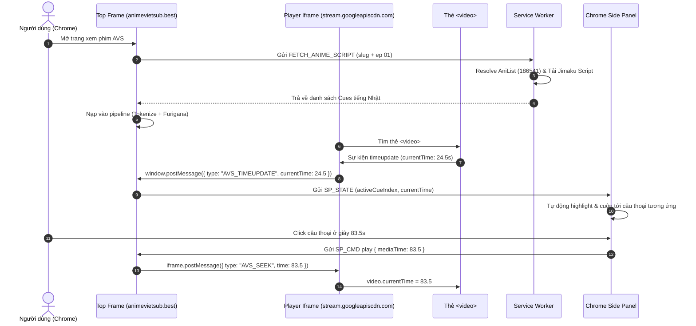

<!-- date: 2026-11-04 -->
<!-- source: user request (/plan /browser /e2e-testing AnimeVietSub test & audit) -->

# Kế hoạch Kiểm Thử (Test Plan): Tự động nạp Script Anime trên AnimeVietSub sang Side Panel

## 1. Kết quả kiểm tra Live Tab (Hiện trạng thực tế)

> [!CAUTION]
> **Hiện trạng**: Tiện ích **HOÀN TOÀN CHƯA HOẠT ĐỘNG (0%)** trên trang `https://animevietsub.best/phim/mezametara-saikyou-soubi-to-uchuusenmochi-datta-node-ikkodate-mezashite-youhei-toshite-jiyuu-ni-ikitai-a6112/xem-phim.html`.

### Bằng chứng kỹ thuật trực tiếp từ runtime & disk:
1. **Manifest chưa match**: `extension/manifest.json` chỉ hỗ trợ `youtube.com`, `abema.tv`, `netflix.com`. Không có `animevietsub.best`, không có `animevietsub.*`.
2. **Content Script không inject**: Đo đạc tab thật qua AppleScript/DOM cho thấy `hasCaptionPanel: false`, `hasOcrBar: false`, `scripts: []`.
3. **Phát hiện vị trí Player (Spike 0 hoàn thành)**:
   - Trang top `animevietsub.best` **không có thẻ `<video>`** (`document.querySelectorAll("video").length === 0`).
   - Video nằm trong iframe cross-origin: `https://stream.googleapiscdn.com/player/5917055df3d6b90a2c1d15b14438f1cbbcf6d2205763e1392e711ee6a790c0a3?...`
   - Truy cập DOM bị trình duyệt chặn: `Blocked a frame with origin "https://animevietsub.best" from accessing a cross-origin frame.`
4. **Mã nguồn chưa implement**: Các module trong kế hoạch ngày 2026-11-02 (`ass_parser.js`, `anime_resolver.js`, nhánh nạp cues AVS trong `content.js`) chưa có trên đĩa.

---

## 2. Rà soát các Bug & Blocker đã đề cập từ trước

Đối chiếu với bản review ngày 2026-11-02 (`review/anime-auto-inject-script-panel-plan-review-2026-11-02.md`) và trạng thái live hôm nay:

| ID | Vấn đề đã nêu | Tình trạng hiện tại | Giải pháp trong Test Plan |
|---|---|---|---|
| **P0-1** | `chrome.sidePanel.open()` cấm tự mở khi tải trang (cần user gesture) | **Vẫn là blocker** nếu hứa auto-open. | Đổi tiêu chí nghiệm thu: mở bằng click icon extension đã ghim hoặc click nút LR trên player. |
| **P0-2** | `bsk` không probe được Chrome Side Panel (vi phạm AGENTS §10) | **Vẫn là blocker** nếu test claim bsk thấy panel. | Tách 3 surface: `bsk` (tab/video), `sp_test_bridge` (logic panel), `screencapture` ngoài (visual). |
| **P0-3** | Thiếu host permissions & sai domain | Link thực tế là `animevietsub.best` (khác `animevietsub.news` ở plan cũ). Thiếu cả `stream.googleapiscdn.com`. | Khai báo host permissions cho `*://*.animevietsub.*/*`, `https://stream.googleapiscdn.com/*`, `https://graphql.anilist.co/*`, `https://jimaku.cc/*`. |
| **P0-4** | `all_frames: true` trên entry cũ gây ô nhiễm site khác | Chưa sửa manifest. | Tạo entry content script riêng cho AVS và entry bridge riêng cho iframe player `stream.googleapiscdn.com`. |
| **P0-5** | Chưa chứng minh được cấu trúc Player & DOM | **Đã chứng minh hôm nay**: Video nằm trong iframe `stream.googleapiscdn.com`. | Xây dựng cơ chế **2-way PostMessage Player Bridge** giữa iframe player và top window. |
| **P0-6** | Trùng Cache Key do URL kết thúc bằng `xem-phim.html` | Logic cũ sẽ tạo key `web__xem-phim`, mọi anime bị trùng đè lên nhau. | Trích xuất slug phim `mezametara-saikyou-soubi-...-a6112` + số tập `01` → `avs__mezameza_a6112__ep01` (≤64 ký tự). |
| **P0-7** | AVS không có MAIN-world page bridge | Thiếu nhánh nạp cues riêng, sẽ dính `page_bridge_timeout`. | Thêm nhánh `loadCachedCues` → `FETCH_ANIME_SCRIPT` → `applyLoadedCues`. |
| **P0-8** | Rò rỉ Jimaku API key lên bridge qua `hardsubSettings` | Chưa tách key riêng. | Lưu `jimakuApiKey` độc lập trong `chrome.storage.local`, có test assert không rò vào `/extension_state`. |
| **P0-9** | Live API contract test không được mock | Đã test hôm nay: Jimaku trả HTTP 401 khi không có key; AniList GraphQL chạy tốt. | Viết contract test thật, báo `NOT TESTED` / cảnh báo khi thiếu key, cấm test giả. |
| **P1 mới** | Tên Romaji trên AVS viết liền không khớp AniList | Live check: `"Mezametara Saikyou Soubi to Uchuusenmochi Datta node..."` ra 0 kết quả; tên tiếng Anh h2 `"Reborn as a Space Mercenary..."` ra ngay AniList ID `186541`. | Resolver tự động tìm bằng English title / alias khi Romaji không khớp. |

---

## 3. Kiến trúc Giải pháp Đồng bộ Iframe Player (Spike 0 Resolution)

---

## 4. Chi tiết Kế hoạch Kiểm Thử 6 Tầng (Test Plan)

### Tầng 1: ASS/SRT Parser Unit Test (`extension/shared/ass_parser_test.js`)
- Test chuyển đổi timestamp ASS/SRT chuẩn (`0:01:23.45` -> `83.45s`).
- Test lọc bỏ toàn bộ override tags: `{\k...}`, `{\pos...}`, `{\fad...}`, ngắt dòng `\N`.
- Test chỉ lấy `Dialogue:`, bỏ `Comment:`, sắp xếp tăng dần theo `start`.
- Test bảo vệ trước file rỗng, lỗi định dạng, UTF-8 BOM.

### Tầng 2: Metadata & API Resolver Test (`extension/shared/anime_resolver_test.js`)
- Test bóc tách metadata AVS:
  + URL `.../xem-phim.html` + active episode `01` → slug + tập `01`.
  + h1: Romaji title; h2: English title / alias.
- Test AniList GraphQL:
  + Tìm bằng Romaji thất bại → Fallback tìm bằng English title thành công (AniList ID `186541`).
- Test Jimaku Contract:
  + Gửi kèm API Key → parse cues.
  + Không có Key → trả HTTP 401 rõ ràng, thông báo người dùng nhập key trong Settings, không crash.

### Tầng 3: Service Worker & Platform Gates Test (`extension/background/service_worker_test.js`)
- Test ma trận 6 cổng nền tảng:
  + `platformFromUrl("https://animevietsub.best/...")` === `"animevietsub"`.
  + `isSupportedUrl` chấp nhận animevietsub.
  + `enabledPlatforms.animevietsub` mặc định `true`.
- Test bảo mật key:
  + `jimakuApiKey` lưu trong `chrome.storage.local`.
  + Assert payload `/extension_state` **hoàn toàn không chứa** `jimakuApiKey`.

### Tầng 4: Content Script & Iframe Bridge Test (`extension/content/content_test.js` & `player_bridge_test.js`)
- Test tạo Cache Key duy nhất:
  + `videoIdFromUrl("https://animevietsub.best/.../xem-phim.html")` ra `animevietsub__mezameza_a6112__ep01` (khác với phim khác cùng tập).
- Test giao tiếp 2 chiều:
  + Giả lập `AVS_TIMEUPDATE` từ iframe player → Top frame cập nhật `currentTime`.
  + Nhận `SP_CMD play` từ Side Panel → Top frame gửi `AVS_SEEK` xuống iframe player.
- Test UI: Nút LR hiển thị làm gesture mở panel; không chèn overlay che video; ẩn `#hardsub-ocr-bar`.

### Tầng 5: E2E Live Smoke Test trên Browser Thật (`scripts/animevietsub_live_smoke.js`)
- Chạy với Evidence Bundle: `python3 ~/.agents/skills/test-evidence/scripts/evidence.py start --slug avs-live-smoke --profile command`.
- **Surface 1 (Tab bsk/Chrome)**:
  + Mở trang AVS tập 01.
  + Kiểm tra player iframe nạp thành công, bridge nhận diện được `<video>`.
  + Kiểm tra cues nạp vào bộ nhớ, thời gian phát `currentTime > 0`.
- **Surface 2 (Logic Side Panel)**:
  + Kích hoạt gesture mở Side Panel qua dev bridge `sp_test_bridge`.
  + Kiểm tra Side Panel nhận `SP_STATE`, render timeline câu thoại tiếng Nhật.
  + Gửi lệnh click câu thoại từ panel → kiểm tra `video.currentTime` nhảy đúng mốc giây.
- **Surface 3 (Visual Evidence)**:
  + Chụp `screencapture` cửa sổ Chrome hiển thị đồng thời video AVS và Side Panel tiếng Nhật.
  + Ghi chú rõ `BSK PROBE: no` theo đúng quy định AGENTS §10.

### Tầng 6: Anti-Fake Gate & Code Integrity
- Chạy `node scripts/verify_no_fake_tests.js` (yêu cầu Exit Code 0, cấm test chuỗi tĩnh).
- Chạy `git diff --check` (không thừa khoảng trắng hay conflict).
- Hoàn tất evidence bundle với `python3 ~/.agents/skills/test-evidence/scripts/evidence.py check --finish --verdict PASS`.

---

## 5. Lộ trình triển khai đề xuất (Execution Phases)

1. **Giai đoạn 1 (Manifest & Platform Plumbing)**: Thêm host permissions (`*.animevietsub.*`, `stream.googleapiscdn.com`, `anilist`, `jimaku`), thêm 6 cổng nền tảng, tạo entry content script riêng.
2. **Giai đoạn 2 (Pure Parser & Resolver)**: Viết `ass_parser.js` và `anime_resolver.js` kèm bộ unit test fixture + live AniList check.
3. **Giai đoạn 3 (Iframe Player Bridge)**: Viết `extension/content/animevietsub_player_bridge.js` chèn vào iframe `stream.googleapiscdn.com` để đồng bộ thời gian và tua video.
4. **Giai đoạn 4 (Content Integration & Side Panel Whitelist)**: Kết nối nhánh nạp cues AVS trong `content.js`, mở whitelist URL cho `sidepanel.js`.
5. **Giai đoạn 5 (E2E Verification & Review)**: Chạy toàn bộ 6 tầng test, thu thập bằng chứng đầy đủ qua `evidence.py`, chạy review chéo độc lập.
