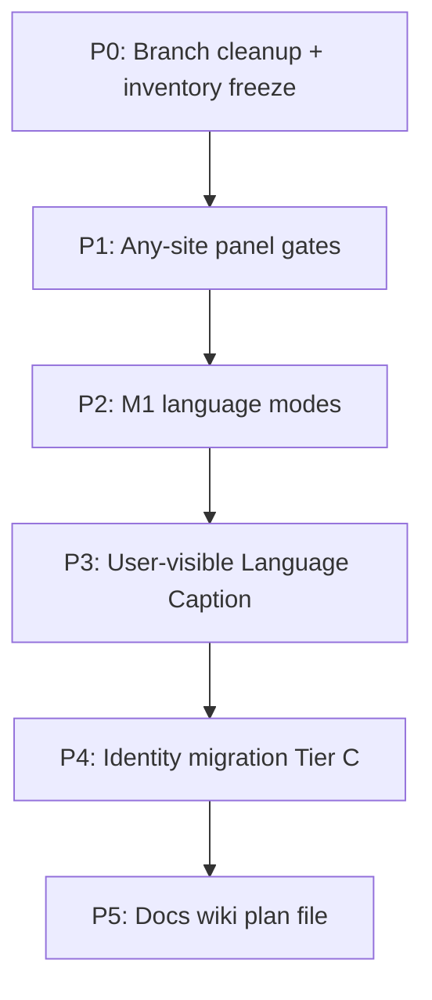

<!-- date: 2026-11-09 -->
<!-- source: chat:cloud · user: Language Caption rebrand C + M1 + panel mọi site -->

# Language Caption — rebrand C + M1 + panel mọi site

<!-- date: 2026-11-09 -->
<!-- source: chat:cloud · user: 1=C, 2=M1 -->

## Quyết định đã khóa

- **Rebrand Tier C:** đổi identity user-facing + technical (GitHub repo, bundle ID, Drive filenames, storage keys, Xcode targets). Có dual-read migration cho dữ liệu cũ.
- **Ngôn ngữ M1:** giữ 3 slot `source` / `en` / `vi`; chọn nguồn `auto|ja|en|vi`; chọn đích dịch trong bộ EN/VI; auto-detect trong trio. JP NLP (Sudachi/furigana/JLPT) chỉ chạy khi nguồn là JA.
- **Panel mọi site:** mở side panel + inject content trên mọi `http(s)`; caption hữu ích phụ thuộc track/import/ASR sẵn có.
- **2 nhánh git:** không merge. `whisper_turbo_audio_evaluation` đã nằm trong `master`. `anime_auto_inject_script_panel` trùng AVS trên master — chỉ cherry-pick docs/tests nếu cần sau.

## Đã kiểm chứng trên disk (2026-11-09)

Các mốc sau được đọc trực tiếp từ file hiện tại, không chỉ từ báo cáo survey:

- Panel bị chặn: `isSupportedUrl` chỉ nhận youtube/abema/netflix/animevietsub dù `platformFromUrl` đã trả `"web"` cho http(s) khác. [extension/background/service_worker.js](extension/background/service_worker.js) dòng 168–185. Test hiện tại **bắt buộc** `https://example.com/x` → `enabled: false`. [extension/background/service_worker_test.js](extension/background/service_worker_test.js) dòng 550–552.
- Manifest chỉ match YT/ABEMA/Netflix/AVS; `frame_relay.js` không có trong manifest. [extension/manifest.json](extension/manifest.json).
- `sourceLang` mặc định `"ja"`; `enabledPlatforms.web` đã `true` nhưng gate URL không dùng nó. [extension/shared/hardsub_defaults.js](extension/shared/hardsub_defaults.js).
- `auto` vẫn cộng điểm JA=90, EN=40. [service_worker.js](extension/background/service_worker.js) `scoreTrack` dòng 1348–1350.
- `detectCuesLanguage` chỉ phân ja/vi/en bằng script heuristics. [extension/content/content.js](extension/content/content.js) dòng 540–549.
- Gemini prompt cố định “Japanese-to-…”. [extension/shared/gemini_translate.js](extension/shared/gemini_translate.js) `translationInstruction`.
- Drive files: `caption-studio-backup.json`, `caption-studio-vocab.json`, `caption-studio-settings.json`. [service_worker.js](extension/background/service_worker.js) ~1460–1700.
- Bundle ID iOS/macOS: `com.example.YouTubeJPCaptionStudio` (+ `.iPhone`, `.Bridge`). `project.yml` / `Info.plist`.
- Git (lệnh trực tiếp): `whisper_turbo_audio_evaluation` ahead=0, behind=194. `anime_auto_inject_script_panel` có 2 commit riêng (`ce2f08e`, `d52facb`).

**Chưa tự diff byte-by-byte:** claim “core AVS trên nhánh anime trùng `cda2666`” là suy luận từ survey, không phải diff thủ công từng file. Trước khi cherry-pick phải `git diff master...origin/anime_auto_inject_script_panel`.

**Là lựa chọn thiết kế, không phải hành vi hiện có:** giữ nhãn file `JA:`/`EN:`/`VI:` khi nguồn không phải JA; giữ class `.lr-*` / id `hardsub-*`; dual-read Drive/storage; bundle ID mới = app cài lại. Những mục này đúng vì bạn chọn C + M1, và phải có test migrate trước khi tin.

## Phased delivery

Làm theo phase; mỗi phase một (hoặc vài) commit rõ ràng. Repo rename GitHub là bước **manual** của bạn ở cuối P4 (agent không đổi tên repo trên GitHub được bằng quyền hiện có).

---

## P0 — Baseline & nhánh

- Làm việc từ `master` (đã có AVS + ASR).
- Không merge `origin/anime_auto_inject_script_panel`. Nếu thiếu: cherry-pick `scripts/animevietsub_translate_smoke.js` + wiki/plan AVS còn thiếu.
- Xóa hoặc archive nhánh remote sau khi xác nhận (bạn approve): whisper đã merge; anime trùng.
- Orphan `extension/content/frame_relay.js` (không trong manifest) — **không** wire thêm trong epic này; ghi note trong plan file.

---

## P1 — Panel trên mọi website (ít rủi ro nhất)

**Gates hiện tại:** [`extension/manifest.json`](extension/manifest.json) matches hẹp; [`isSupportedUrl`](extension/background/service_worker.js) loại `"web"`; [`isSupportedVideoUrl`](extension/sidepanel/sidepanel.js) allowlist; content không inject ngoài YT/ABEMA/Netflix/AVS.

**Sửa tối thiểu:**

1. `manifest.json`: thêm `http://*/*`, `https://*/*` vào `host_permissions`; mở rộng idle `content_scripts` (+ `web_accessible_resources` nếu cần MAIN inject). Giữ AVS CDN bridge match hẹp (`stream.googleapiscdn.com`).
2. `service_worker.js`: `isSupportedUrl` = mọi `http(s)` (vẫn loại `chrome://`, `chrome-extension://`). `syncSidePanelForTab` / action click theo đó.
3. `sidepanel.js`: `isSupportedVideoUrl` mirror; đổi copy “chỉ YouTube/Netflix/ABEMA”.
4. `settings_modal.js`: expose toggle platform `web` (default đã `true` trong [`hardsub_defaults.js`](extension/shared/hardsub_defaults.js)).
5. Cập nhật test: [`extension/background/service_worker_test.js`](extension/background/service_worker_test.js) (hiện expect `example.com` → disabled).

**Acceptance:** mở panel trên `https://example.com`; content nhận `SP_CMD`; YouTube/Netflix/ABEMA/AVS không regress. Caption trên site lạ = `loadPageCues` / Import / ASR — không hứa timedtext YouTube-class.

---

## P2 — M1 language modes

**Giữ schema:** `cues[].source` + `en` + `vi` (bridge [`ScriptCue`](local-bridge/app/schemas/models.py), iOS `textJA`/`textEN`/`textVI` wire vẫn map vào 3 slot; label UI đổi theo ngữ cảnh nguồn).

**Settings** ([`hardsub_defaults.js`](extension/shared/hardsub_defaults.js) + [`SettingsPanel.tsx`](web/saved-items/src/components/SettingsPanel.tsx) + iOS `@AppStorage` sync):

| Key | Values | Behavior |
|-----|--------|----------|
| `sourceLang` | `auto` \| `ja` \| `en` \| `vi` | Track preference + primary slot fill |
| `targetLangs` | subset of `["en","vi"]` (default both) | Gemini + bar/sidepanel show |
| (giữ) `barShowJa/En/Vi` | bool | Display; khi source≠ja, “JA row” = primary `source` label theo lang thật |

**Logic:**

1. **`auto`:** dùng `detectCuesLanguage` + YouTube `languageCode` (`matchLangFamily`); bỏ bias cứng JA=90 khi user chọn auto — score theo detection/track code trong `{ja,en,vi}`.
2. **Primary fill:** track được chọn → `cues[].source`; không nhét EN/VI vào primary nếu detect nói khác (đã có guard trong `applyLoadedCues` — generalize).
3. **Secondary:** các lang còn lại trong trio fill `en`/`vi` columns như hiện tại (`fill_yt_secondary.js`).
4. **Gemini** ([`gemini_translate.js`](extension/shared/gemini_translate.js)): prompt theo cặp `(sourceLang → target)` trong trio; không còn hardcode “Japanese-to-…”. Queue jobs theo `targetLangs`.
5. **NLP gate:** `/tokenize_batch`, furigana, JLPT, IME `ja-JP` **chỉ** khi `sourceLang===ja` (hoặc detect=`ja`). Source EN/VI → skip Sudachi; tokens rỗng/neutral.
6. **UI:** sidepanel toggles + settings “Ngôn ngữ nguồn” gồm `vi`; thêm multi-select đích EN/VI; empty-state copy không nói “chỉ JP”.

**Không làm trong M1:** ngôn ngữ ngoài ja/en/vi; đổi cột Drive/script `JA:/EN:/VI:` labels (vẫn map semantic: `JA:` line = primary `source` text dù nguồn là EN — ghi chú trong docs; đổi label file format = breaking, để sau nếu cần).

**Tests:** unit cho `detectCuesLanguage` + `normalizeSettings` (`sourceLang: vi`, `targetLangs`); Gemini instruction builder; content NLP-skip khi non-JA; không pseudo string-match.

---

## P3 — User-visible “Language Caption”

Đổi chuỗi hiển thị trước khi đụng identity nặng:

- [`extension/manifest.json`](extension/manifest.json): `name`, `description`, `default_title`
- Sidepanel / settings / reload / audio_capture titles
- Player badge `LR` → `LC`; tooltip bỏ “Language Reactor” → “Language Caption”
- Saved Items: `YT CAPTION` → `Language Caption` ([`web/saved-items/src/app/layout.tsx`](web/saved-items/src/app/layout.tsx)); rebuild popup
- iOS `CFBundleDisplayName` + `ContentView` title
- macOS bridge display name
- Root [`README.md`](README.md) / [`walkthrough.md`](walkthrough.md) (feature blurb)

Giữ internal CSS `.lr-*` / DOM `hardsub-*` ở phase này (Tier C identity ≠ rename 1000 class nội bộ). Đổi class CSS chỉ nếu bạn yêu cầu thêm — **mặc định giữ** để diff nhỏ.

---

## P4 — Identity migration (Tier C)

### 4a. Storage keys (extension + web + iOS)

| Cũ | Mới |
|----|-----|
| `hardsubSettings` | `languageCaptionSettings` |
| `@AppStorage("hardsub…")` | prefix `languageCaption…` (map 1-1) |

**Migrate-on-read:** đọc key mới; nếu thiếu → đọc key cũ → ghi key mới. Giữ dual-read ≥1 release. Defaults module có thể rename file sau (`hardsub_defaults.js` → `lc_defaults.js`) hoặc giữ filename + export alias — chọn **giữ filename nội bộ**, chỉ đổi storage key + UI brand (ít đụng import).

### 4b. Drive filenames

| Cũ | Mới |
|----|-----|
| `caption-studio-backup.json` | `language-caption-backup.json` |
| `caption-studio-vocab.json` | `language-caption-vocab.json` |
| `caption-studio-settings.json` | `language-caption-settings.json` |
| backup `format: caption-studio-sentence-backup` | `language-caption-sentence-backup` |

**Dual-read/write:** lookup tên mới trước, fallback tên cũ; write luôn tên mới; accept cả hai `format` khi restore. Cùng pattern ở [`BackupService.swift`](ios-shared/Sources/CaptionShared/) / VocabSync / SettingsSync + [`service_worker.js`](extension/background/service_worker.js).

### 4c. iOS / macOS bundle IDs & Xcode

- Bundle ID: `com.example.YouTubeJPCaptionStudio` (+ `.iPhone`, `.Bridge`, `.drive-oauth`) → `com.example.LanguageCaption` (+ suffixes).
- Rename targets / schemes / `@main` `YouTubeJPCaptionStudioApp` → `LanguageCaptionApp` via `project.yml` + regenerate.
- LaunchAgent plist labels `com.youtubejpcaptionstudio.*` → `com.languagecaption.*`; cập nhật [`COMMANDS.md`](ipad-app/Scripts/COMMANDS.md).
- **Hệ quả:** app = install mới; SwiftData cũ không chuyển tự động. Ghi rõ trong walkthrough; Drive sync vẫn kéo vocab/settings nếu user login cùng folder (nhờ dual-read).

### 4d. Extension ID & scripts

Unpacked ID phụ thuộc path load. Sau khi đổi folder/repo:

- Cập nhật [`scripts/reload-extension.sh`](scripts/reload-extension.sh), AGENTS §9, capture scripts — **sau** khi đo ID mới (không đoán).
- Native Messaging / OAuth client allowlist: bạn cập nhật Google Cloud Console với ID mới.
- Giữ hướng dẫn one-time “Load unpacked” nếu ID đổi.

### 4e. GitHub repo rename (manual)

- Đề xuất tên: `language-caption` (user: `sonhoang10800-afk/language-caption`).
- Bạn rename trên GitHub Settings → agent cập nhật README clone URL, CI badges, path docs.
- Remote cũ GitHub thường redirect; vẫn sửa link trong repo.

### 4f. Không đổi trong epic (tránh phá vỡ vô ích)

- CSS `.lr-*`, DOM id `hardsub-*`, global `Hardsub*` (internal)
- OAuth client ID strings (chỉ allowlist extension ID / bundle ID trên Console)
- `DRIVE_FOLDER_ID` cố định (cùng folder; chỉ đổi tên file)
- File lịch sử `plan/` `review/` (immutable per AGENTS)

---

## P5 — Docs / wiki / plan artifact

- File plan durable: [`plan/language-caption-rebrand-m1-2026-11-09.md`](plan/language-caption-rebrand-m1-2026-11-09.md) (copy từ plan đã confirm).
- Ingest wiki: topic mới `wiki/topics/language-caption-rebrand.md`; cập nhật `wiki/index.md` + `wiki/log.md`.
- Skill: rename/retarget [`skills/youtube-caption`](skills/youtube-caption) → `skills/language-caption` (cập nhật AGENTS catalog §5).
- `TODOS.md` / README discovery blurb.

---

## Map chỉnh sửa chính (checklist)

**Extension:** `manifest.json`, `background/service_worker.js`, `sidepanel/sidepanel.js|html`, `content/content.js`, `content/settings_modal.js`, `shared/hardsub_defaults.js`, `shared/gemini_translate.js`, `shared/fill_yt_secondary.js` (nếu cần), tests SW/content, reload scripts.

**Web:** `web/saved-items` settings types + `SettingsPanel.tsx` + layout brand → `npm run check` + rebuild extension popup.

**Bridge:** prompt/docs only cho M1; script `JA:/EN:/VI:` giữ; optional skip tokenize khi caller gửi `lang!=ja` (header/body flag) nếu extension đã gate — bridge có thể thêm `lang` optional no-op.

**iOS/macOS:** Info.plist, project.yml, ContentView, Backup/Vocab/Settings sync, App.swift rename.

**Repo meta:** README, walkthrough, AGENTS extension id section, skills catalog.

---

## Rủi ro

- Tier C bundle ID = mất local SwiftData trên device đến khi Drive restore.
- Đổi storage key thiếu migrate-on-read = mất settings user.
- `<all_urls>` content script = review Chrome Web Store khó hơn + CSP/perf trên mọi trang — chấp nhận vì requirement; giữ work nhẹ khi `enabledPlatforms.web` off / `enabled` off.
- M1 `auto` sai detect trên caption hỗn hợp → primary lệch; giữ heuristics hiện có + ưu tiên YouTube `languageCode` khi có.
- Repo/extension ID đổi gãy reload script đến khi đo ID mới.

## Test plan (khi implement)

1. SW unit: `isSupportedUrl('https://example.com')===true`; chrome URLs false.
2. Settings normalize: `sourceLang`/`targetLangs` round-trip; defaults test web app.
3. NLP skip: non-JA source không gọi `/tokenize_batch` (spy/mock bridge trong test hiện có nếu có; hoặc content unit).
4. Gemini instruction: JP→VI, EN→VI, VI→EN strings đúng.
5. Drive dual-read: fixture tên cũ vẫn load (test bridge/extension layer có thể unit constants).
6. Manual (nếu Cloud có Chrome): panel trên example.com + YouTube regress — ghi artifact.
7. `git diff --check`; không pseudo string-match tests.

## Ngoài scope (ghi nhận cho sau)

- M2/M3 đa ngôn ngữ ngoài trio
- Đổi CSS `.lr-*` / rename `Hardsub*` internals
- Wire `frame_relay.js`
- Chrome Web Store listing
- Đổi `DRIVE_FOLDER_ID` / OAuth client mới (chỉ allowlist)
